

  

Este repositório reúne o trabalho desenvolvido na disciplina de **Sistemas Inteligentes (UFMA)**. O **Slime Mould Algorithm (SMA)** é aplicado ao **Permutation Flow Shop Scheduling (PFS)** para encontrar sequências de trabalhos que minimizem o *Total Tardiness* (atraso total).

Os experimentos estão organizados por semana, desde a implementação inicial até o uso de **Optuna**, **redes neurais surrogate** e **controle Fuzzy**.

## Arquitetura do projeto

  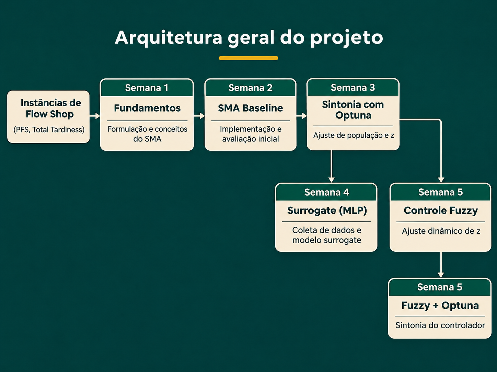

As etapas de **Surrogate** e **Fuzzy** são investigações distintas realizadas a partir do SMA. A sintonia Fuzzy com Optuna amplia o experimento de controle adaptativo.

## Etapas do projeto

### Semana 01 — Fundamentos

Estudo da formulação do SMA, uma meta-heurística bioinspirada no comportamento do mofo-limo (*Physarum polycephalum*). A apresentação introduz seus operadores de atualização e o funcionamento da busca populacional.

[Apresentação (PDF)](01%20-%20Fundamentos/SMA_slides%20%282%29%20%281%29.pdf)

  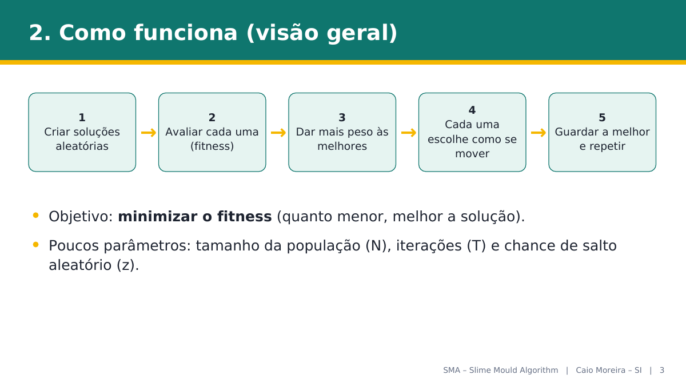

### Semana 02 — SMA Baseline

Implementação do solver para PFS usando **Random Keys** para representar permutações e a `FlowShopEngine` para calcular o atraso total. O notebook apresenta as instâncias, testes básicos, curvas de convergência e uma comparação com busca aleatória.

[Notebook Baseline](02%20-%20Baseline/Baseline%20-%20Slime%20Mould%20Algorithm%20%28SMA%29%20aplicado%20ao%20Flow%20Shop.ipynb)

  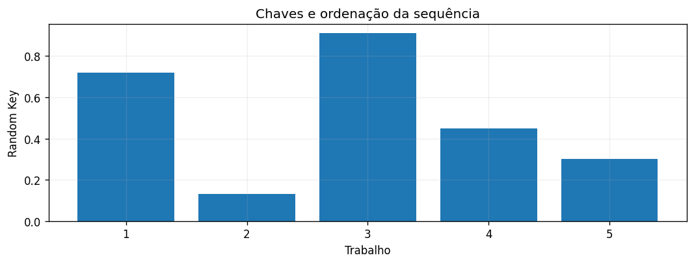
  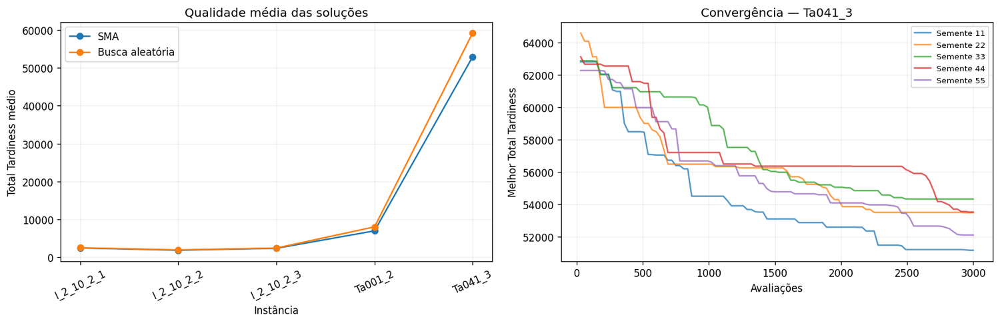

### Semana 03 — Sintonia com Optuna

Busca automática de configurações para o **tamanho da população** e a **taxa de reinicialização (`z`)**. As tentativas são registradas e analisadas para comparar o SMA com e sem sintonia de hiperparâmetros.

[Notebook Optuna](03%20-%20Optuna/Otimiza%23U00e7%23U00e3o%20de%20hiperpar%23U00e2metros%20do%20SMA%20com%20Optuna.ipynb)

  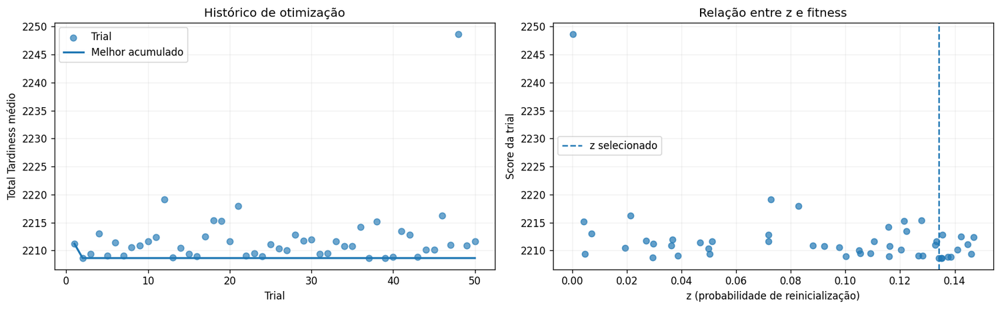
  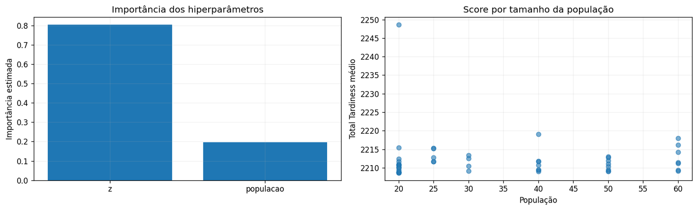

### Semana 04 — Modelo Surrogate (MLP)

Treinamento de uma **MLP** para estimar o fitness das soluções a partir de exemplos avaliados pela função objetivo. O conjunto de treinamento combina amostragem **Latin Hypercube** e soluções visitadas pelo SMA. A rede auxilia a seleção de candidatos, enquanto a `FlowShopEngine` confirma as soluções selecionadas.

[Notebook Surrogate](04%20-%20Surrogate/Treinamento%20e%20integra%23U00e7%23U00e3o%20de%20um%20modelo%20surrogate.ipynb)

  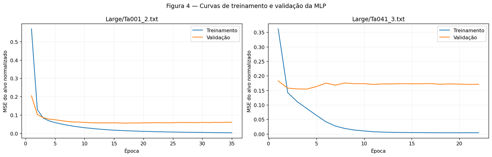
  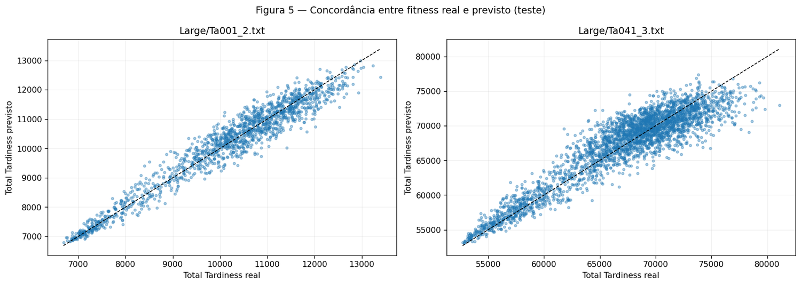

### Semana 05 — Controle Fuzzy Adaptativo

Implementação de um controlador Fuzzy que observa a **diversidade populacional** e a **estagnação da busca** para ajustar `z` a cada geração. O notebook compara o SMA com parâmetro fixo e o SMA com controle adaptativo.

[Notebook Fuzzy](05%20-%20Fuzzy/Controle%20Fuzzy%20Adaptativo%20do%20Slime%20Mould%20Algorithm.ipynb)

  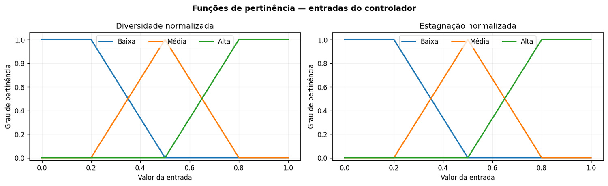
  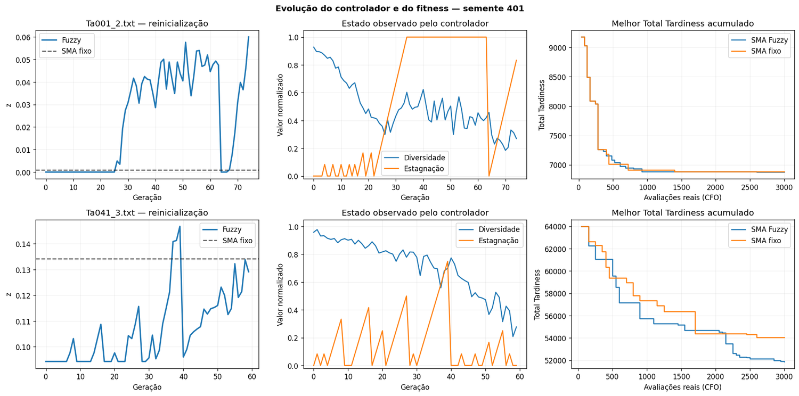

### Semana 05 — Extensão: Fuzzy + Optuna

Sintonia das intensidades dos ajustes de `z` e da janela de estagnação com Optuna. O experimento compara **SMA fixo**, **Fuzzy original** e **Fuzzy sintonizado**, incluindo análise das configurações e das superfícies de controle.

[Notebook Fuzzy + Optuna](05%20-%20Fuzzy/Controle%20Fuzzy%20Adaptativo%20do%20SMA%20Sintonia%20com%20Optuna.ipynb)

  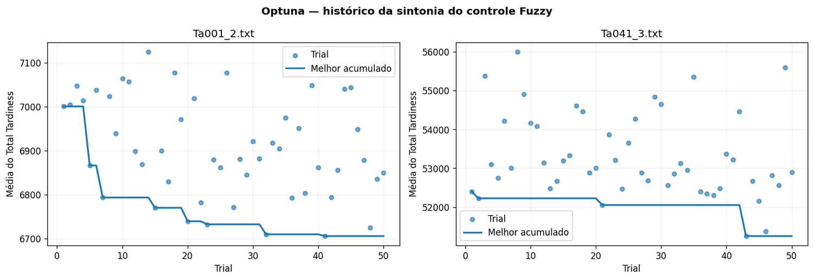
  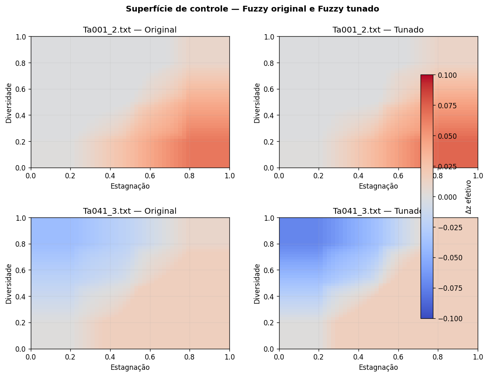

## Organização do repositório

| Diretório | Conteúdo |
|:--|:--|
| [`01 - Fundamentos`](01%20-%20Fundamentos/) | Apresentação teórica do SMA |
| [`02 - Baseline`](02%20-%20Baseline/) | Implementação, testes e resultados iniciais |
| [`03 - Optuna`](03%20-%20Optuna/) | Sintonia de hiperparâmetros e avaliações |
| [`04 - Surrogate`](04%20-%20Surrogate/) | MLP e experimentos de aproximação do fitness |
| [`05 - Fuzzy`](05%20-%20Fuzzy/) | Controle adaptativo e sintonia do controlador |

**Tecnologias:** Python, NumPy, Pandas, Matplotlib, Optuna, scikit-learn, PyTorch e Jupyter Notebook.

**Escopo:** as instâncias são provenientes do conjunto DPFSP_DD, mas os experimentos utilizam a formulação **PFS com uma única fábrica**, com minimização do *Total Tardiness*. A versão distribuída não é avaliada.
